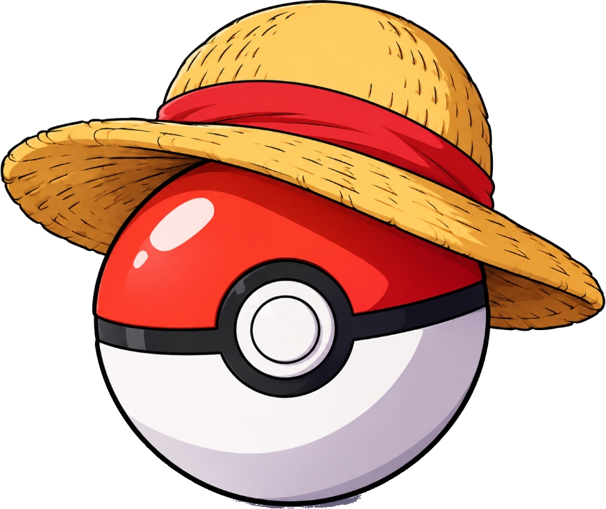
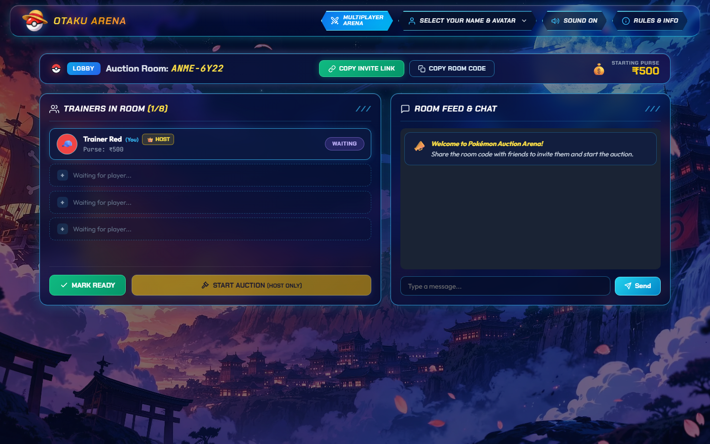
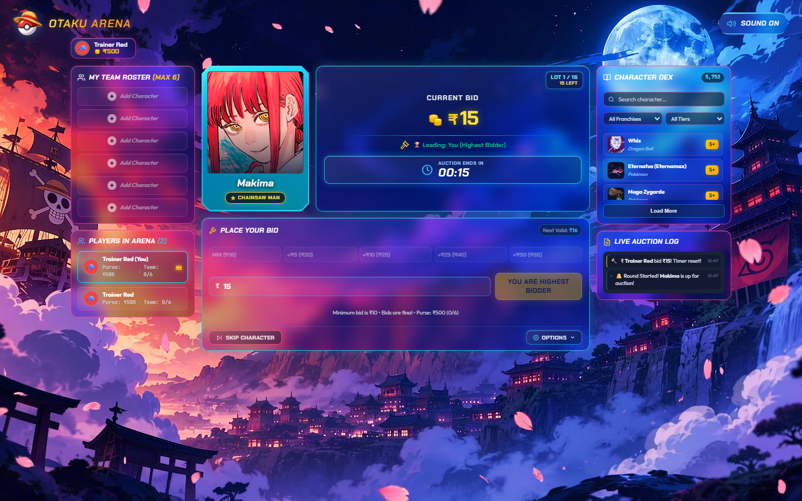
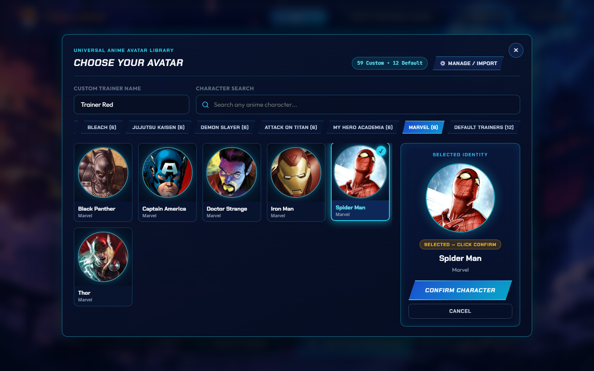
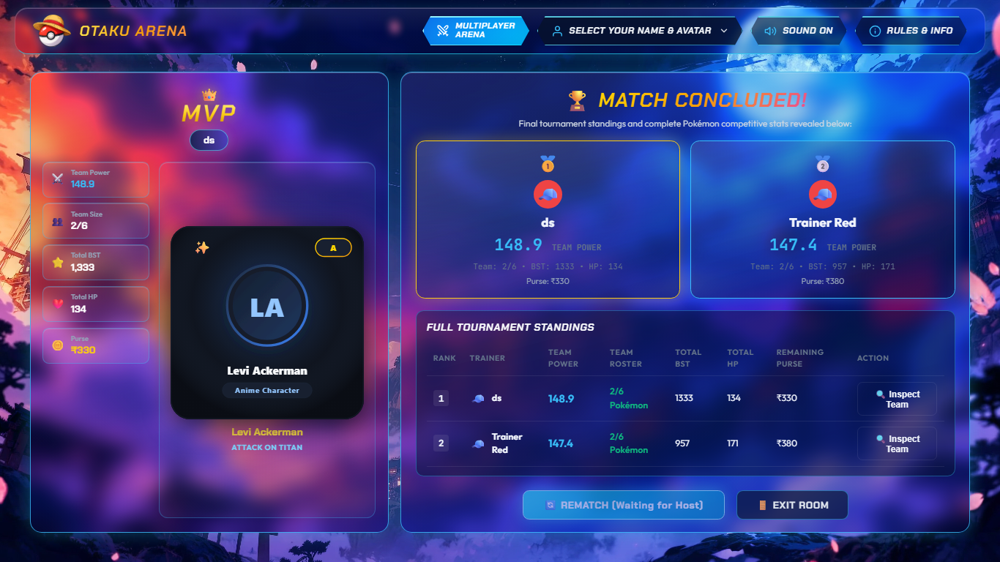
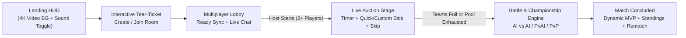
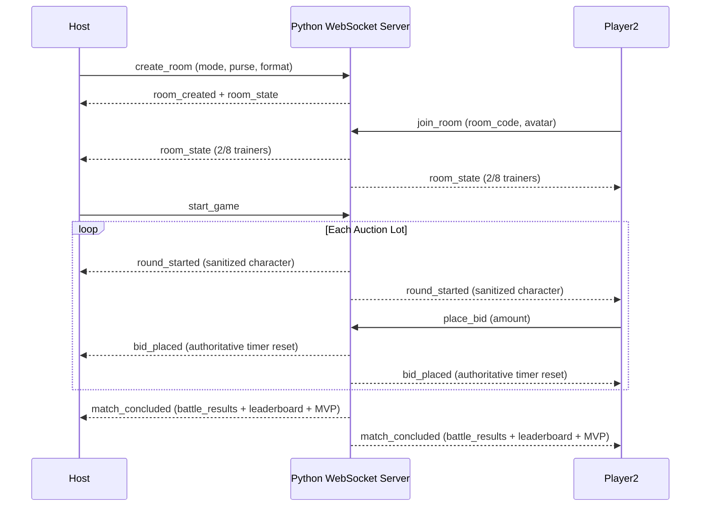

<div align="center">



# OTAKU ARENA

**Real-Time Cross-Universe Multiplayer Auction & Championship Battle Platform**


</div>

---

## Overview

**Otaku Arena** is a real-time multiplayer character auction and cross-universe battle platform spanning **Pokémon**, **30+ Anime Franchises** (One Piece, Naruto, Dragon Ball, Attack on Titan, Demon Slayer, Jujutsu Kaisen, Bleach, My Hero Academia, etc.), and **Marvel Comics** (**5,752+ characters** across **32 universes**).

Players enter a cinematic **liquid-glass anime HUD**, bid against opponents in real time with carry-over purse strategy, draft up to 6 characters without seeing hidden stats until the auction concludes, and compete in simulated or interactive **Round-Robin / Championship Bracket** battles with a **Dynamic Category-Based MVP Showcase**.

---

## Visual Showcase

### 1. Multiplayer Auction Lobby
> Horizontal room banner with one-click invite links, live readiness sync, waiting slots, and real-time room chat.



### 2. Live Liquid-Glass Auction Stage
> 3-column neon HUD over a 4K animated anime background video: Team Roster & Trainers in Arena (left), Futuristic Cyan Character Card + Current Bid + Bidding Console (center), and searchable Character Dex + Live Auction Log (right).



### 3. Character-Based Avatar Library (10 Franchises)
> 59+ local face-cropped character portraits across One Piece, Naruto, Dragon Ball, Attack on Titan, Demon Slayer, Jujutsu Kaisen, My Hero Academia, Bleach, Pokémon, and Marvel.



### 4. Match Concluded & Dynamic Category-Based MVP
> Category-aware MVP selector (Anime / Marvel / Pokémon) paired with Tournament Standings, Battle Records, and Rematch controls.



---

## System Architecture & Gameplay Flow



### Real-Time WebSocket Synchronization



---

## Key Features

- **32 Franchises & 5,752+ Characters**: Unified catalog combining Pokémon, Anime, and Marvel Comics with power ratings, tiers (`S+` to `D`), and transformation/form modes.
- **Tactile Tear-Ticket Room Modal**: Interactive React + Motion tear-off ticket (`src/components/TearTicket.jsx`) for creating and joining rooms.
- **Liquid-Glass 3-Column Auction HUD**: Translucent neon cyan/pink panels, live `LOT X / Y` & `Z LEFT` pool counter, quick-bid increments (`MIN`, `+₹5`, `+₹10`, `+₹25`, `+₹50`), `SKIP CHARACTER`, and live `CHARACTER DEX`.
- **10-Category Circular Avatar Library**: Local portrait storage under `public/assets/avatars/<franchise>/` synced via `src/local_avatars.py` and propagated across lobby, stage, log, and standings.
- **Cross-Universe Battle & Championship Engine**: Supports `AI vs AI`, `Player vs AI`, and `Player vs Player` modes with Round-Robin and Championship Bracket formats.
- **Dynamic Category-Based MVP System**: Deterministic MVP resolver (`public/mvp-config.js`) tailored to Anime, Marvel, Pokémon, Single-Franchise, and Multi-Franchise rooms with graceful empty-roster and artwork fallbacks.

---

## Quick Start

### Prerequisites
- Python **3.10+**
- Node.js **18+** (only required if rebuilding the React JSX bundle)

### 1. Run the Server
```bash
pip install websockets pillow
python server.py 5050
```
Open **http://127.0.0.1:5050/** in your browser.

### 2. Rebuild React UI Components (Optional)
```bash
npm install
npx esbuild src/components/AuctionTicketModal.jsx --bundle --outfile=public/assets/tear-ticket-bundle.js --loader:.jsx=jsx --jsx=automatic --external:/assets/* --minify
```

### 3. Run Tests
```bash
# Dynamic MVP Selector unit tests
node tests/test_mvp_selector.js

# Backend database, battle & reliability suite (with server running on 5050)
python -m unittest discover -s tests
```

---

## Project Structure

```text
pokemon-auction-game/
├── server.py                  # Async HTTP + WebSocket server & room orchestrator
├── public/
│   ├── index.html             # Single-page HUD, Lobby, Auction Stage & Results
│   ├── styles.css             # Liquid-glass neon styling & responsive breakpoints
│   ├── game.js                # Real-time WebSocket client, UI renderers & Dex
│   ├── mvp-config.js          # Configurable category MVP pools & deterministic resolver
│   └── assets/
│       ├── avatars/           # 10 franchise folders + manifest.json
│       ├── landing-video.mp4  # Unified animated background video
│       └── tear-ticket-bundle.*
├── src/
│   ├── components/            # React TearTicket, AuctionCharacterCard & CodeSlots
│   ├── anime_database.py      # 32-franchise character database manager
│   ├── room_manager.py        # Multiplayer rooms, bidding, skip & leaderboard engine
│   ├── battle_manager.py      # Cross-universe combat & championship simulation
│   └── local_avatars.py       # Local avatar folder scanner & manifest generator
├── data/                      # Anime, Pokémon & Marvel JSON/SQLite databases
└── tests/                     # Unit & integration test suites
```
